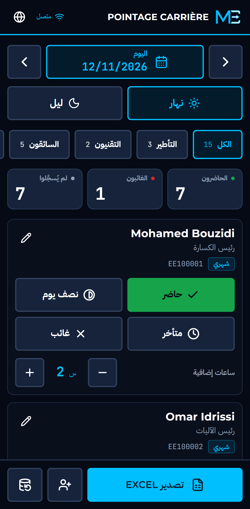
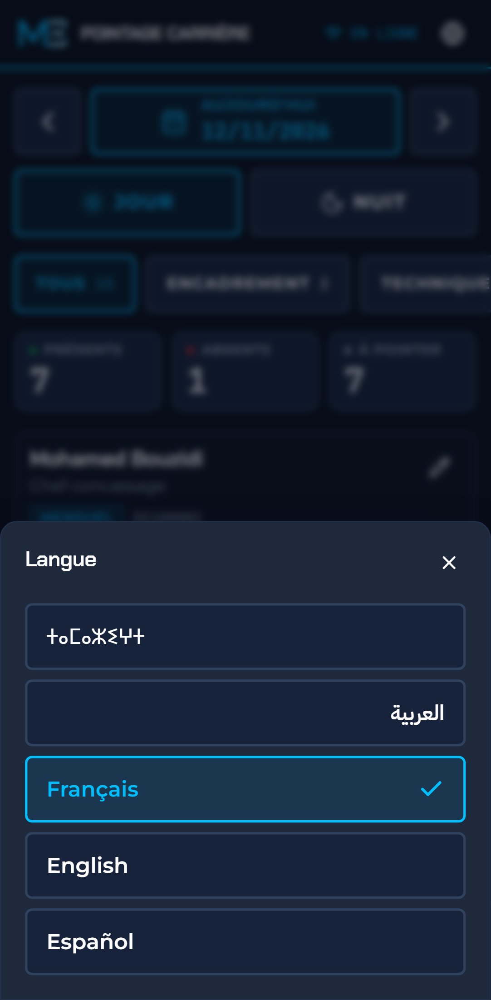
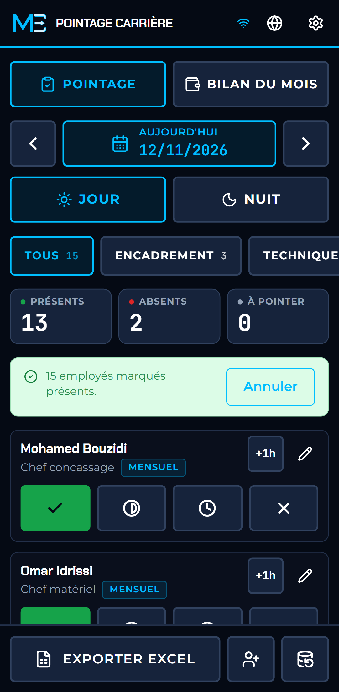
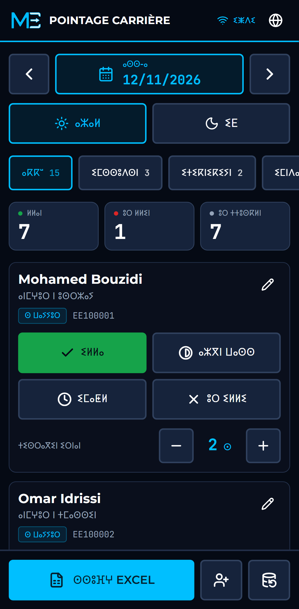

<div dir="rtl">

# Pointage Carrière

**تسجيل الحضور دون اتصال في محطات التكسير وغسل الرمل.** ضغطة واحدة لكل مستخدَم على الهاتف، بوجود الشبكة أو بدونها، وملف Excel واضح لإعداد الأجور في آخر الشهر.

[ⵜⴰⵎⴰⵣⵉⵖⵜ](README.zgh.md) · **العربية** · [Français](README.fr.md) · [English](README.md) · [Español](README.es.md)

<p>
  
  
  
  
</p>

## ما هو هذا التطبيق

في أغلب محطات التكسير بنواحي مراكش، يُسجَّل الحضور في دفتر ورقي، ثم يُعاد إدخاله في ملف Excel لا يفهمه إلا شخص واحد. تضيع الصفحات، وتختلّ المجاميع عند النسخة الثالثة، ويبدأ الخلاف حول الأجور في آخر الشهر.

يعوّض هذا التطبيق الدفتر. يفتحه رئيس المحطة على هاتفه، ويضغط مرة واحدة على كل مستخدَم، فيُحفظ التسجيل على الجهاز. وفي آخر الشهر، زر واحد يُخرج ملف Excel الذي يحتاجه المحاسب. يعمل التطبيق في قاع الوادي دون شبكة، وسط الغبار، وباليد المقفَّزة.

التطبيق حرّ الاستعمال والتعديل والمشاركة تحت رخصة MIT، ولا يتطلب حساباً ولا خادماً ولا اشتراكاً.

**النسخة التجريبية:** https://meskikcode.github.io/quarry-pointage-lite/ (افتحها على الهاتف ثم ثبِّتها).

## ما يقوم به

- **الجميع حاضرون بضغطة واحدة.** في أغلب الأيام يكون الجميع حاضرين تقريباً. زر واحد يسجّل الطاقم كله حاضراً (أو فريقاً واحداً)، ثم تُصحَّح الاستثناءات القليلة. يمكن التراجع عنه، ولا يمحو أبداً تسجيلاً سابقاً.
- **تسجيل الحضور بضغطة واحدة.** حاضر، نصف يوم، متأخر أو غائب، في صف واحد من الأزرار الكبيرة. وللغياب سبب: غير مبرَّر، مرض أو مرخَّص. الضغط مرة ثانية على الحالة المختارة يمحوها.
- **وردية النهار ووردية الليل**، لكل واحدة تسجيلاتها، وفي أي تاريخ.
- **حصيلة الشهر في نظرة واحدة.** لكل مستخدَم: أيام العمل والغيابات والساعات الإضافية والمستحق أداؤه، مع مجموع الشهر، داخل التطبيق وليس في ملف Excel فقط.
- **الساعات الإضافية** لكل مستخدَم ولكل وردية: زر «+1 س» يفتح عدّاداً عند وجود ساعات للتعديل.
- **طاقم المحطة كما هو في الواقع.** رئيس الكسارة، رئيس الآليات، المحاسب، الكهربائي المشغِّل، اللحّام، سائقو الجرافة والحفارة والشاحنة، العمال والحراس. وأي منصب آخر (عامل الوقود، عامل الميزان، أمين المخزن) يُدخَل بتسميته، لأن المحطات لا تتشابه في طواقمها.
- **طريقتان للأداء**، كما في الميدان:
  - *شهري*: بعقد عمل. الأجر مستحق عن الشهر ولو غاب المستخدَم بعض الأيام، والساعات الإضافية مؤدّاة.
  - *يومي*: يؤدّى عن أيام العمل. ولا تؤدّى الساعات الإضافية إلا إذا أُدخلت تعريفة للساعة.
- **التسبيقات.** المال المسلَّم قبل يوم الأداء يُسجَّل لكل مستخدَم، بتاريخه وملاحظة، ويُخصم من المتبقي للأداء. والرصيد السالب يظهر بالأحمر.
- **تصدير Excel شهري، جاهز للمحاسب.** ثلاث أوراق: ملخص لكل مستخدَم (أيام العمل، الغيابات حسب السبب، الساعات الإضافية، الأجر الأساسي، الأجر التقديري، التسبيقات، المتبقي للأداء)، وجميع تسجيلات الحضور، وجميع التسبيقات. بعنوان، ورأس جدول ثابت، وأرقام وتواريخ حقيقية، وسطر للمجموع، واتجاه من اليمين إلى اليسار. هو وسيلة لإعداد الأجور وليس تصريحاً للصندوق الوطني للضمان الاجتماعي.
- **نسخة احتياطية واسترجاع.** البيانات موجودة على الجهاز فقط، لذلك تُحفظ القاعدة كلها في ملف وتُسترجع منه.
- **تذكير بالنسخة الاحتياطية.** حين يمر أسبوع على آخر نسخة (أو ثلاثة أيام بعد أول استعمال على جهاز لم يُنسخ قط)، تظهر رسالة بذلك مع زر لإنجازها.
- **شهر المستخدَم يوماً بيوم.** تقويم يبيّن بالألوان وردية النهار ووردية الليل لكل تاريخ.
- **اسم الموقع** أعلى الشاشة وفي كل ورقة Excel.
- **البدء من قائمة فارغة.** محو الطاقم التجريبي (وكل شيء) بضغطتين، وحذف مستخدَم أُضيف خطأً. ومن له حضور أو تسبيقات لا يمكن إلا تعطيله، فلا يتغيّر أي شهر مضى.
- **سهل الاستعمال للجميع.** كل شاشة ونافذة تجتاز تدقيقاً آلياً وفق WCAG 2.1 AA بالفرنسية والعربية، وكل شيء يُستعمل بلوحة المفاتيح.
- **خمس لغات**: الأمازيغية (تيفيناغ)، العربية، الفرنسية، الإنجليزية والإسبانية.
- **قابل للتثبيت ويعمل دون اتصال تماماً.** بعد الزيارة الأولى يشتغل دون أي شبكة.
- **جميع أحجام الشاشات**، من هاتف بعرض 320 بكسل إلى شاشة المكتب.

## الخصوصية

لا حساب، ولا خادم، ولا تتبُّع. لا يرسل التطبيق أي طلب إلى طرف ثالث: الخطوط والأيقونات ومكتبة Excel مضمَّنة فيه. تبقى الأسماء وأرقام البطاقات والأجور في قاعدة المتصفح على الجهاز، ولا تغادره إلا في الملفات التي يصدّرها المستعمل بنفسه.

## التثبيت على الهاتف

1. افتح النسخة التجريبية في Chrome على أندرويد (أو Safari على آيفون).
2. في Chrome: القائمة ثم **إضافة إلى الشاشة الرئيسية** أو **تثبيت التطبيق**. في Safari: مشاركة ثم **إضافة إلى الشاشة الرئيسية**.
3. افتح التطبيق من الشاشة الرئيسية. يعمل بعد ذلك دون اتصال.

الطاقم الظاهر عند أول تشغيل وهمي. عدِّل تلك البطاقات أو عطِّلها، ثم أدخل الطاقم الحقيقي.

## التشغيل محلياً

يتطلب Node.js 22.12 أو أحدث.

<div dir="ltr">

```bash
git clone https://github.com/MeskikCode/quarry-pointage-lite.git
cd quarry-pointage-lite
npm install
npm run dev
```

</div>

الوثائق التقنية بالإنجليزية: [تصميم النظام](docs/system-design.md)، [نموذج البيانات](docs/data-model.md)، [نظام التصميم](docs/design-system.md)، [الترجمات](docs/translations.md).

## نطاق المشروع

يبقى المشروع صغيراً عن قصد، ليعمل دون اتصال تماماً على هاتف واحد دون أي إعداد. ولا يشمل:

- المزامنة بين عدة هواتف، ولا لوحة متابعة في المكتب؛
- الربط بوصولات الميزان وبالحمولة المنتَجة؛
- نظام الأجور الكامل: الاقتطاعات، القروض على عدة أشهر، وبيانات الأجر المطبوعة.

الأفكار والاحتياجات القادمة من الميدان مرحَّب بها عبر [issues](https://github.com/MeskikCode/quarry-pointage-lite/issues).

## الترخيص

الشيفرة منشورة تحت [رخصة MIT](LICENSE)، وحقوقها محفوظة لـ Abdelmalek MESKIK. اسم MeskikCode وشعاره غير مشمولَين بهذه الرخصة.

---

يتولى صيانته [مسكيكُّود](https://meskikcode.com) من مراكش (الاسم التجاري لـ Abdelmalek MESKIK).

</div>
