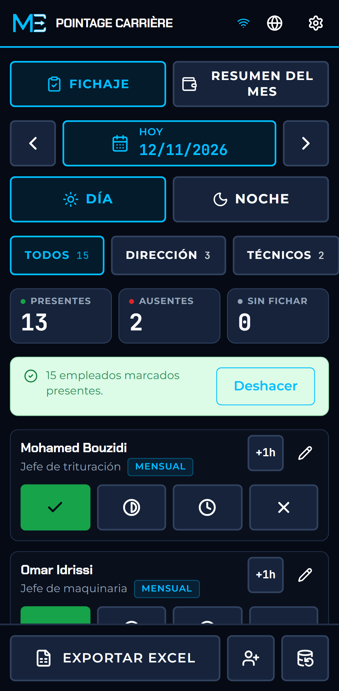
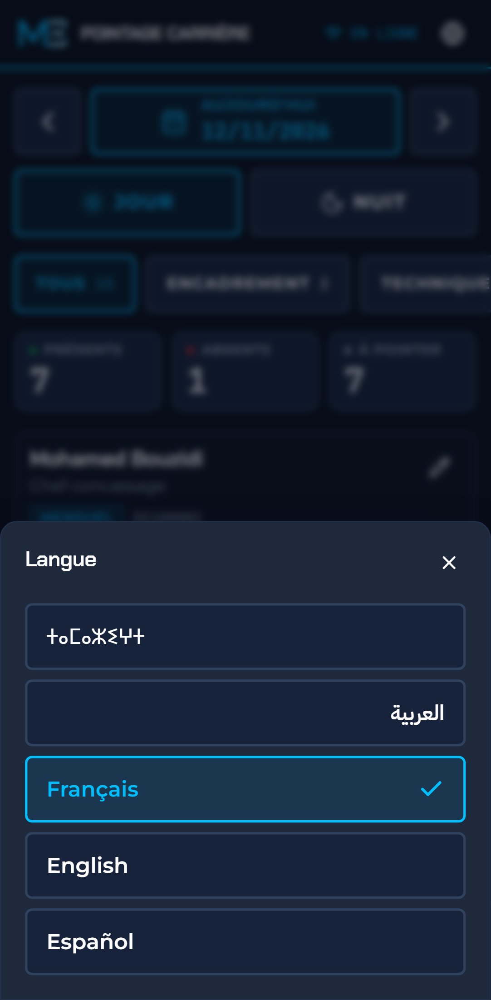
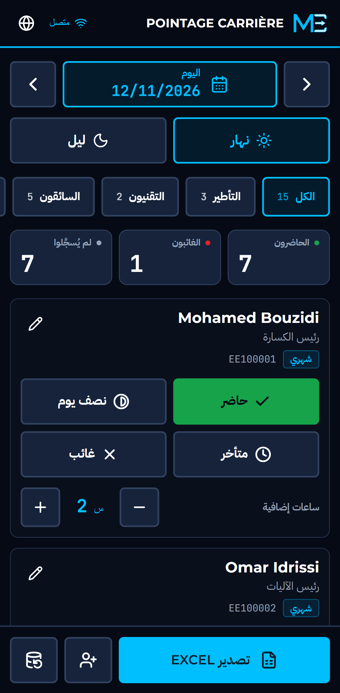
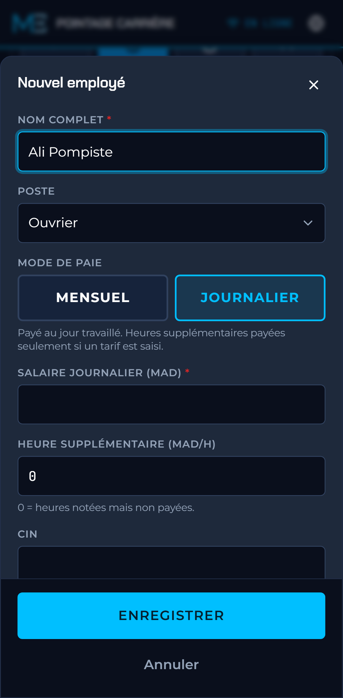

# Pointage Carrière

**Control de asistencia sin conexión para plantas de trituración y lavado de arena.** Un toque por empleado en el teléfono, con o sin cobertura, y un archivo Excel limpio para la nómina a final de mes.

[ⵜⴰⵎⴰⵣⵉⵖⵜ](README.zgh.md) · [العربية](README.ar.md) · [Français](README.fr.md) · [English](README.md) · **Español**

<p>
  
  
  
  
</p>

## Qué es

En la mayoría de las plantas de trituración de la región de Marrakech, la asistencia se apunta en un cuaderno y luego se vuelve a teclear en una hoja de cálculo que solo entiende una persona. Se pierden páginas, los totales fallan a la tercera copia y la nómina se discute a final de mes.

Pointage Carrière sustituye al cuaderno. El jefe de planta lo abre en su teléfono, toca una vez a cada empleado y el fichaje queda guardado en el dispositivo. A final de mes, un botón genera el archivo Excel que necesita el contable. Funciona en el fondo de un cauce sin cobertura, con polvo y con guantes.

Es libre de usar, adaptar y compartir bajo la licencia MIT. No necesita cuenta, ni servidor, ni suscripción.

**Demostración:** https://meskikcode.github.io/quarry-pointage-lite/ (abrir en un teléfono e instalar).

## Qué hace

- **Todos presentes con un toque.** La mayoría de los días casi todos están. Un botón marca presente a toda la plantilla (o a un solo equipo) y se corrigen las pocas excepciones. Se puede deshacer y nunca sobrescribe a quien ya está fichado.
- **Fichaje con un toque.** Presente, media jornada, retraso o ausente, en una sola fila de botones grandes. Una ausencia lleva un motivo: injustificada, enfermedad o autorizada. Un segundo toque sobre el estado elegido lo borra.
- **El mes de un vistazo.** Por empleado: días trabajados, ausencias, horas extra y lo que se debe pagar, con el total del mes, en la aplicación y no solo en el archivo Excel.
- **Turnos de día y de noche**, cada uno con sus fichajes, en cualquier fecha.
- **Horas extra** por empleado y por turno: un botón «+1 h» que abre un contador cuando hay horas que ajustar.
- **La plantilla real de una planta.** Jefe de trituración, jefe de maquinaria, contable, electricista-operador, soldador, conductores de cargadora, excavadora y camión, obreros y vigilantes. Cualquier otro puesto (surtidor de gasóleo, agente de báscula, almacenero) se introduce con su propio nombre, porque no hay dos plantas con la misma plantilla.
- **Dos formas de pago**, como en el terreno:
  - *Mensual*: con contrato. El salario se debe por el mes aunque falten días, y las horas extra se pagan.
  - *Por día*: se paga por día trabajado. Las horas extra solo se pagan si se indica una tarifa por hora.
- **Anticipos.** El dinero entregado antes del día de pago se anota por empleado, con fecha y nota, y se descuenta de lo pendiente de pago. Un saldo negativo aparece en rojo.
- **Exportación mensual a Excel, lista para el contable.** Tres hojas: un resumen por empleado (días trabajados, ausencias, horas extra, salario base, paga estimada, anticipos, pendiente de pago), todos los fichajes y todos los anticipos. Con título, encabezado fijo, números y fechas reales, fila de totales e impresión apaisada. Es una ayuda para preparar la nómina, no una declaración a la CNSS.
- **Copia de seguridad y restauración.** Los datos solo existen en el dispositivo: toda la base se guarda en un archivo y se restaura desde él.
- **Un aviso para hacer la copia.** Cuando la última copia tiene una semana (o tres días tras el primer uso, en un dispositivo sin copia), un aviso lo indica, con el botón que la hace.
- **El mes de un empleado, día a día.** Un calendario muestra en color el turno de día y de noche de cada fecha.
- **El nombre del sitio** arriba en la pantalla y en cada hoja de Excel.
- **Empezar de cero.** Borrar la plantilla de ejemplo (y todo lo demás) con dos toques, y eliminar un empleado añadido por error. Quien tiene fichajes o anticipos solo puede desactivarse: ningún mes pasado cambia.
- **Accesible.** Cada pantalla y cada ventana pasan una auditoría automática WCAG 2.1 AA en francés y árabe, y todo se maneja con el teclado.
- **Cinco idiomas**: tamazight (tifinagh), árabe (de derecha a izquierda), francés, inglés y español.
- **Instalable y totalmente sin conexión.** Tras la primera visita arranca sin ninguna red.
- **Todos los tamaños de pantalla**, desde un teléfono de 320 px hasta un monitor de escritorio.

## Privacidad

No hay cuenta, ni servidor, ni analítica. La aplicación no hace ninguna petición a terceros: fuentes, iconos y la biblioteca de Excel van incluidos. Los nombres, los documentos de identidad y los salarios permanecen en la base del navegador, en el dispositivo, y solo salen en los archivos que exporta el usuario.

## Instalar en un teléfono

1. Abrir la demostración en Chrome en Android (o Safari en iPhone).
2. Chrome: menú y **Añadir a pantalla de inicio** o **Instalar aplicación**. Safari: Compartir y **Añadir a pantalla de inicio**.
3. Abrirla desde la pantalla de inicio. A partir de ahí funciona sin conexión.

La plantilla que aparece en el primer arranque es ficticia. Editar o desactivar esas fichas e introducir la plantilla real.

## Ejecutar en local

Requiere Node.js 22.12 o posterior.

```bash
git clone https://github.com/MeskikCode/quarry-pointage-lite.git
cd quarry-pointage-lite
npm install
npm run dev
```

La documentación técnica está en inglés: [diseño del sistema](docs/system-design.md), [modelo de datos](docs/data-model.md), [sistema de diseño](docs/design-system.md), [traducciones](docs/translations.md).

## Alcance

El proyecto se mantiene pequeño a propósito, para funcionar totalmente sin conexión en un solo teléfono, sin nada que configurar. No incluye:

- la sincronización entre varios teléfonos, ni un panel en la oficina;
- el enlace con los tiques de báscula y el tonelaje producido;
- la nómina completa: retenciones, préstamos a varios meses y recibos de salario impresos.

Las ideas y necesidades de plantas reales son bienvenidas como [issues](https://github.com/MeskikCode/quarry-pointage-lite/issues).

## Licencia

El código se publica bajo la [licencia MIT](LICENSE), copyright Abdelmalek MESKIK. El nombre y el logotipo de MeskikCode no están cubiertos por esa licencia.

---

Mantenido por [MeskikCode](https://meskikcode.com) en Marrakech (nombre comercial de Abdelmalek MESKIK).
