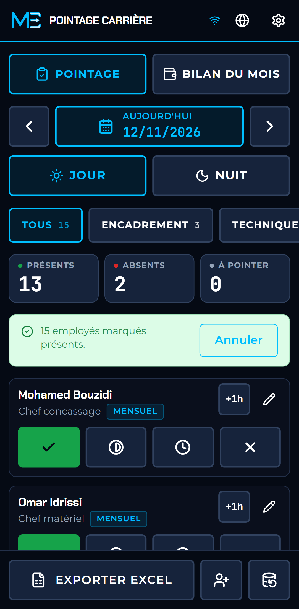
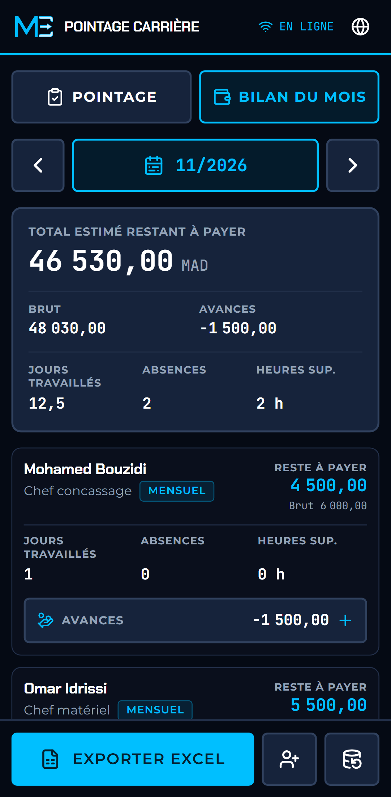
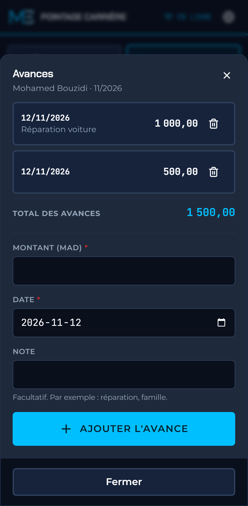
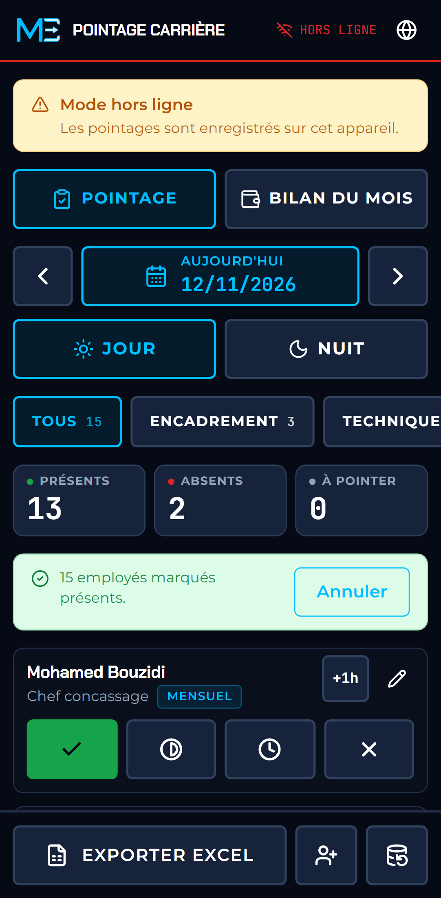

# Pointage Carrière

**Le pointage hors ligne des stations de concassage et de lavage de sable.** Un appui par employé sur le téléphone, avec ou sans réseau, et un fichier Excel propre pour la paie en fin de mois.

[ⵜⴰⵎⴰⵣⵉⵖⵜ](README.zgh.md) · [العربية](README.ar.md) · **Français** · [English](README.md) · [Español](README.es.md)

<p>
  
  
  
  
</p>

## De quoi s'agit-il

Sur la plupart des stations de concassage autour de Marrakech, le pointage tient dans un cahier, puis il est ressaisi dans un fichier Excel qu'une seule personne comprend. Des pages se perdent, les totaux sont faux à la troisième copie, et la paie se discute en fin de mois.

Pointage Carrière remplace le cahier. Le chef de station l'ouvre sur son téléphone, appuie une fois par employé, et le pointage est enregistré sur l'appareil. En fin de mois, un bouton produit le fichier Excel dont le comptable a besoin. L'application fonctionne au fond d'un lit d'oued sans réseau, dans la poussière, avec des gants.

C'est un petit produit complet, publié en source ouverte pour montrer comment MeskikCode travaille : un périmètre fixe, un outil conçu pour ceux qui s'en servent, et qui fonctionne là où le travail se fait.

**Démonstration :** https://meskikcode.github.io/quarry-pointage-lite/ (à ouvrir sur un téléphone, puis à installer).

## Ce que fait l'application

- **Tout le monde présent en un appui.** La plupart des jours, presque tout le monde est là. Un bouton marque toute l'équipe présente (ou une seule équipe), puis on corrige les quelques exceptions. L'action s'annule, et elle n'écrase jamais quelqu'un déjà pointé.
- **Pointage en un appui.** Présent, demi-journée, retard ou absent, sur une seule rangée de grands boutons. Une absence porte un motif : non justifiée, maladie ou autorisée. Un second appui sur le statut choisi l'efface.
- **Le mois en un coup d'œil.** Pour chaque employé : jours travaillés, absences, heures supplémentaires et paie à verser, avec le total du mois, dans l'application et pas seulement dans le fichier Excel.
- **Postes de jour et de nuit**, chacun avec ses pointages, à n'importe quelle date.
- **Heures supplémentaires** par employé et par poste : un bouton « +1 h », qui ouvre un compteur dès qu'il y a des heures à ajuster.
- **L'effectif réel d'une station.** Chef concassage, chef matériel, comptable, électricien-opérateur, soudeur, conducteurs de chargeuse, de pelle et de camion, ouvriers et gardiens. Tout autre poste (pompiste, agent de pesée, magasinier) se saisit avec son propre intitulé, car aucune station n'a le même effectif.
- **Deux modes de paie**, comme sur le terrain :
  - *Mensuel* : sous contrat. Le salaire est dû pour le mois même si des jours manquent, et les heures supplémentaires sont payables.
  - *Journalier* : payé au jour travaillé. Les heures supplémentaires ne sont payées que si un tarif horaire est saisi pour l'employé.
- **Avances.** L'argent remis avant la paie se saisit par employé, avec une date et une note, et se déduit du reste à payer. Un solde négatif s'affiche en rouge.
- **Export Excel mensuel, prêt pour le comptable.** Trois feuilles : un récapitulatif par employé (jours travaillés, absences par motif, heures supplémentaires, salaire de base, heures à payer, paie estimée, avances, reste à payer), tous les pointages, et toutes les avances. Avec titre, en-tête figé, vrais nombres et vraies dates, ligne de total et impression en paysage. C'est une aide à la préparation de la paie, pas une déclaration CNSS.
- **Sauvegarde et restauration.** Les données n'existent que sur l'appareil : toute la base s'enregistre dans un fichier et se restaure depuis ce fichier.
- **Cinq langues** : tamazight (tifinagh), arabe (de droite à gauche), français, anglais et espagnol.
- **Installable et entièrement hors ligne.** Après la première visite, l'application démarre sans aucun réseau.
- **Toutes les tailles d'écran**, du téléphone de 320 px au moniteur de bureau.

## Confidentialité

Pas de compte, pas de serveur, pas de mesure d'audience. L'application n'envoie aucune requête à un tiers : polices, icônes et bibliothèque Excel sont embarquées. Les noms, les numéros de CIN et les salaires restent dans la base du navigateur, sur l'appareil, et n'en sortent que dans les fichiers exportés par l'utilisateur. Un test automatique échoue si l'application contacte une autre origine.

## Installer sur un téléphone

1. Ouvrir la démonstration dans Chrome sur Android (ou Safari sur iPhone).
2. Chrome : menu, puis **Ajouter à l'écran d'accueil** ou **Installer l'application**. Safari : Partager, puis **Sur l'écran d'accueil**.
3. Ouvrir l'application depuis l'écran d'accueil. Elle fonctionne désormais sans connexion.

L'équipe affichée au premier lancement est fictive. Modifier ou désactiver ces fiches, puis saisir l'effectif réel.

## Lancer en local

Node.js 22.12 ou plus récent.

```bash
git clone https://github.com/MeskikCode/quarry-pointage-lite.git
cd quarry-pointage-lite
npm install
npm run dev          # serveur de développement sur http://localhost:3000
```

Le service worker n'est actif que dans la version de production :

```bash
npm run build        # export statique dans out/, avec le service worker
npm run preview      # sert out/ sur http://localhost:4173
```

Vérifications : `npm run lint`, `npm run typecheck`, `npm test` (133 tests unitaires), `npm run test:e2e` (76 tests de bout en bout, téléphone et bureau).

## Comment c'est construit

Next.js exporté en fichiers statiques, base IndexedDB (Dexie) sur l'appareil, service worker Serwist qui met tout l'export en cache, write-excel-file pour Excel, Tailwind CSS sur les jetons du système de design MeskikCode. Les règles (pointage, paie, export, sauvegarde) sont des fonctions simples dans `src/lib/`, testées sans navigateur.

La documentation technique est en anglais : [conception du système](docs/system-design.md), [modèle de données](docs/data-model.md), [système de design](docs/design-system.md), [traductions](docs/translations.md), [cahier des charges](BLUEPRINT.md).

## État des traductions

Le français, l'arabe, l'anglais et l'espagnol ont été rédigés par MeskikCode. **Les textes en tamazight sont un brouillon** qui n'a pas encore été relu par un lecteur natif. Les corrections sont les bienvenues : voir [docs/translations.md](docs/translations.md).

## Hors de cette édition

Cette édition ouverte est volontairement réduite. Sont réalisés pour les clients, en projet privé :

- la synchronisation entre plusieurs téléphones et un tableau de bord au bureau, au retour du réseau ;
- le lien entre les postes, les bons de pesée et le tonnage produit ;
- la paie complète : retenues CNSS et fiscales, prêts sur plusieurs mois, bulletins imprimés.

## Projets sur mesure

MeskikCode développe des logiciels sur mesure pour l'industrie, le BTP et la santé, au Maroc, en Afrique et au-delà : des fichiers Excel fragiles à un seul système sécurisé, à un prix fixe convenu avant le début des travaux.

- Site : https://meskikcode.com
- Courriel : abdelmalek@meskik.com
- Téléphone et WhatsApp : 0657-89-01-84 · https://wa.me/212657890184
- LinkedIn : https://www.linkedin.com/company/meskikcode/

## Licence

Le code est publié sous [licence MIT](LICENSE), copyright Abdelmalek MESKIK. Le nom et le logo MeskikCode ne sont pas couverts par cette licence. Les polices sont sous licence SIL Open Font License.

---

Conçu à Marrakech, pour le Maroc d'abord, puis l'Afrique, la région MENA, l'Europe et le monde.
MeskikCode — nom commercial d'Abdelmalek MESKIK. *Votre vision, notre passion.*
