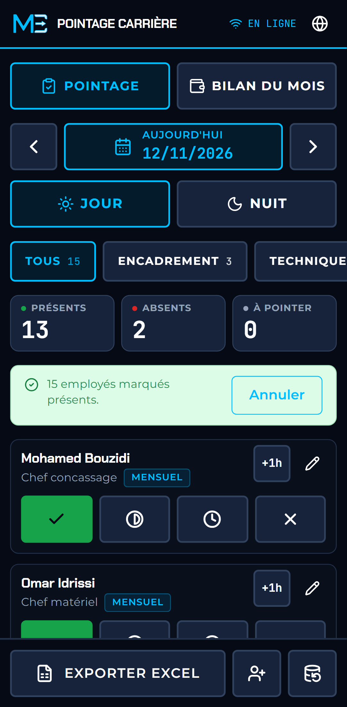
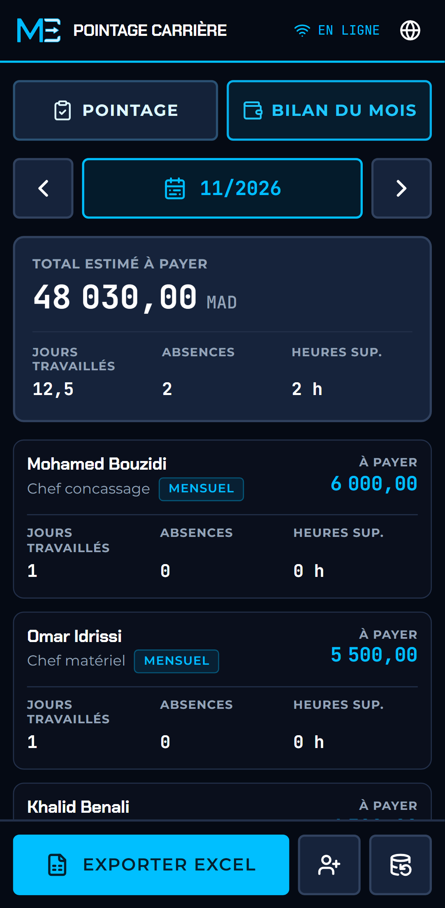
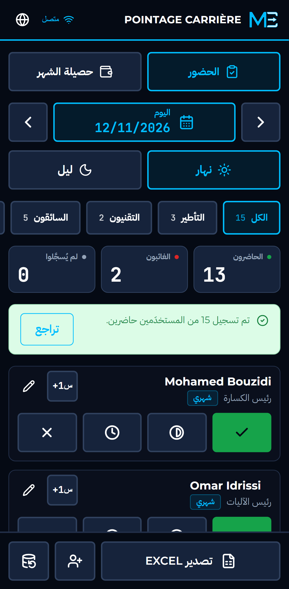
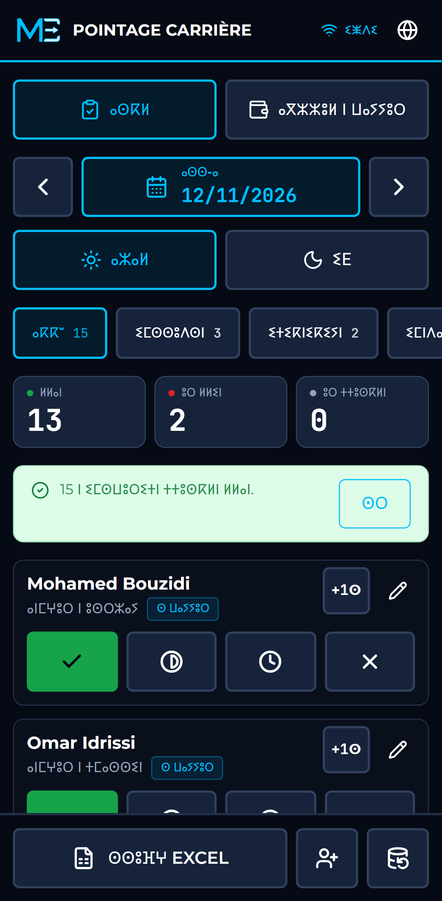
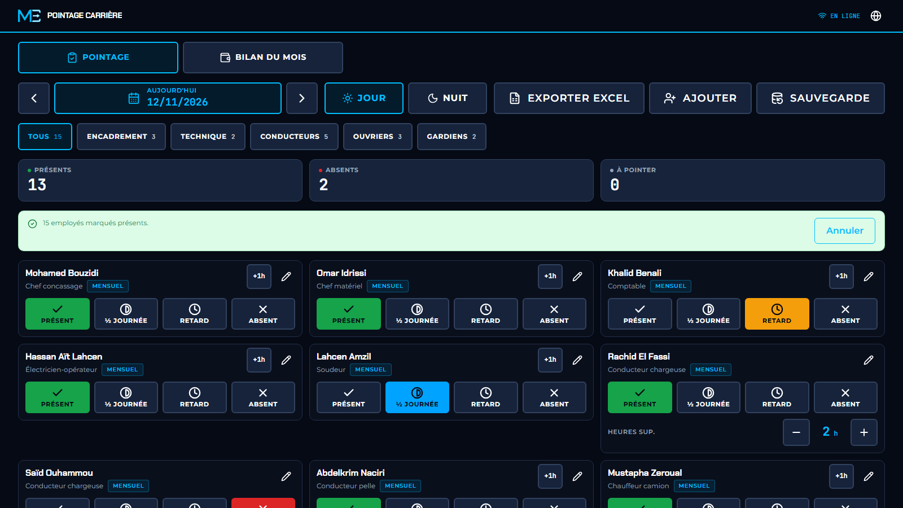

# Pointage Carrière

**Offline-first attendance for crushing and sand-washing sites.** One tap per employee on a phone, with or without signal, and one clean Excel file for payroll at the end of the month.

[ⵜⴰⵎⴰⵣⵉⵖⵜ](README.zgh.md) · [العربية](README.ar.md) · [Français](README.fr.md) · **English** · [Español](README.es.md)

<p>
  
  
  
  
</p>



## What it is

On most crushing sites around Marrakech, attendance lives in a paper notebook and is retyped into a spreadsheet that one person understands. Pages get lost, the totals are wrong by the third copy, and payroll is argued over at the end of the month.

Pointage Carrière replaces the notebook. The site chief opens it on a phone, taps each employee once, and the record is saved on the device. At the end of the month one button produces the Excel file the accountant needs. It works at the bottom of a riverbed with no network, in dust, with gloves on.

It is a small, complete product, published in the open as an example of how MeskikCode builds: fixed scope, built for the people who use it, and working where the work happens.

**Live demo:** https://meskikcode.github.io/quarry-pointage-lite/ (open it on a phone, then install it).

## What it does

- **Everyone present in one tap.** On most days almost everyone is there. One button marks the whole crew present (or one team), and you correct the few exceptions. It can be undone, and it never overwrites someone already marked.
- **One-tap attendance.** Present, half day, late or absent, in a single row of large buttons. An absence takes a reason: unjustified, sick or authorised. Tapping the selected status again clears it.
- **The month at a glance.** For each employee: days worked, absences, overtime and the pay due, with the total for the month, in the application and not only in the Excel file.
- **Day and night shifts**, each with its own records, and any past or future date.
- **Overtime hours** per employee and per shift: one "+1 h" button, which opens a stepper once there is overtime to adjust.
- **The staff of a real site.** Chef concassage, chef matériel, accountant, electrician-operator, welder, loader, excavator and truck drivers, workers and guards. Any other post (fuel attendant, weighbridge agent, storekeeper) is entered with its own title, because no two sites are staffed alike.
- **Two ways of being paid**, as on site:
  - *Monthly*: under contract. The salary is due for the month even when some days are missed, and overtime is payable.
  - *Daily*: paid for the days worked. Overtime is paid only if an hourly rate is set for that employee.
- **Monthly Excel export.** A summary sheet per employee (days worked, half days, late arrivals, absences by reason, overtime, base pay, overtime pay, estimated pay) and a detail sheet with every record. It is an aid for preparing payroll, not a CNSS declaration.
- **Backup and restore.** The data exists only on the device, so the whole database can be saved to a file and restored from it.
- **Five languages**: Tamazight (Tifinagh), Arabic (right to left), French, English and Spanish.
- **Installable and fully offline.** After the first visit it starts with no network at all.
- **Every screen size**, from a 320px phone to a desktop monitor.

## Privacy

There is no account, no server and no analytics. The application makes no request to any third party: fonts, icons and the spreadsheet library are bundled. Names, identity numbers and wages stay in the browser's database on the device and leave it only in the files the user exports. An automated test fails if the application ever contacts another origin.

## Install it on a phone

1. Open the live demo in Chrome on Android (or Safari on iPhone).
2. Chrome: menu, then **Add to Home screen** or **Install app**. Safari: Share, then **Add to Home Screen**.
3. Open it from the home screen. From now on it works without a connection.

The sample crew shown on first launch is fictional. Edit or deactivate those entries and add the real staff.

## Run it locally

Requires Node.js 22.12 or later.

```bash
git clone https://github.com/MeskikCode/quarry-pointage-lite.git
cd quarry-pointage-lite
npm install
npm run dev          # development server on http://localhost:3000
```

The service worker is only active in the production build:

```bash
npm run build        # static export in out/, with the service worker
npm run preview      # serves out/ on http://localhost:4173
```

Checks:

```bash
npm run lint
npm run typecheck
npm test             # 75 unit tests
npm run test:e2e     # 66 end-to-end tests, phone and desktop (after npm run build)
npm run audit:layout # 12 widths x 5 languages, reports anything clipped (needs npm run preview)
```

## How it is built

| Concern | Choice |
| --- | --- |
| Application | Next.js (App Router), React, TypeScript, exported as static files |
| Storage | IndexedDB through Dexie, on the device only |
| Offline | Serwist service worker precaching the whole export |
| Export | SheetJS, loaded only when a file is written |
| Interface | Tailwind CSS over the MeskikCode design system tokens |
| Tests | Vitest for the rules, Playwright for the application |

The rules (attendance, pay, export, backup) are plain functions in `src/lib/`, tested without a browser. The components only render and call them.

- [System design](docs/system-design.md): layers, offline strategy, updates
- [Data model](docs/data-model.md): tables, pay rules, migrations, backup format
- [Design system](docs/design-system.md): how the MeskikCode tokens are applied
- [Translations](docs/translations.md): how to review or add a language
- [Blueprint](BLUEPRINT.md): the original specification and what changed

## Status of the translations

French, Arabic, English and Spanish were written by MeskikCode. **The Tamazight strings are a draft** that has not yet been reviewed by a native reader; quarry and payroll vocabulary is not fully standardised in Tifinagh. Corrections are very welcome: see [docs/translations.md](docs/translations.md).

## Not in this edition

This is the open edition, deliberately small. The following are built for clients as private work:

- Sync between several phones and an office dashboard when the network returns
- Linking shifts to weighbridge tickets and production tonnage
- Full payroll: CNSS and tax deductions, advances, printed pay slips

## Custom work

MeskikCode builds custom software for industry, construction and healthcare businesses in Morocco, Africa and beyond: from fragile spreadsheets to one secure system, at a fixed price agreed before work starts.

- Website: https://meskikcode.com
- Email: abdelmalek@meskik.com
- Phone and WhatsApp: +212 657 89 01 84 · https://wa.me/212657890184
- LinkedIn: https://www.linkedin.com/company/meskikcode/

## Licence

The code is released under the [MIT Licence](LICENSE), copyright Abdelmalek MESKIK.

The MeskikCode name and logo are not covered by that licence. Forks are welcome; please replace the logo in `scripts/brand/` and `public/brand/` and run `npm run icons`. The fonts are under the SIL Open Font License.

---

Built in Marrakech, for Morocco first, then Africa, the MENA region, Europe and the world.
MeskikCode — trading name of Abdelmalek MESKIK. *Your Vision, Our Passion.*
